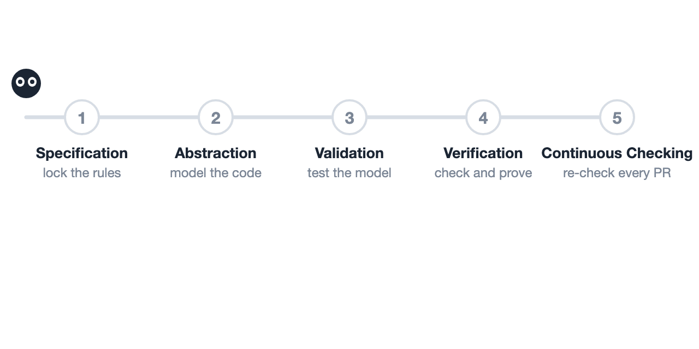

# vstack

`vstack` is a formal verification workflow and skill stack for coding agents. It guides agents through **TLA+ (`TLC`, `Apalache`, `TLAPS`), `Z3`, and runtime trace validation** to uncover deep concurrency bugs and build provable state-machine cores in distributed systems.



## Quick Start

### 1. Install

Add `vstack` skills and agents to your workspace (Claude Code, Cursor, or Codex):

```bash
git clone https://github.com/yuxuandexter/vstack.git
mkdir -p .claude/skills .claude/agents
cp -r vstack/skills/* .claude/skills/
cp -r vstack/agents/* .claude/agents/
```

Or load `vstack` directly as a plugin:

```bash
# Claude Code
claude --plugin-dir ./vstack

# Cursor (once registered in Cursor Plugins)
/add-plugin vstack
```

### 2. Run `/vstack-mode`

Give `/vstack-mode` a target component and the safety property you want to check or prove:

```text
/vstack-mode verify that our RDMA KV cache lease manager never recycles an in-flight page on timeout.
Done means: a trace-validated TLA+ model reproduces any race and passes with the fix.
```

`/vstack-mode` routes your task to one of four built-in playbooks:

- **[`hunt-system-bugs`](skills/vstack-mode/playbooks/hunt-system-bugs.md)** — Extract a model from existing code, replay traces, and find multi-step concurrency counterexamples.
- **[`build-provable-core`](skills/vstack-mode/playbooks/build-provable-core.md)** — Co-design a compact state machine and prove unbounded inductive invariants with `Apalache` and `TLAPS`.
- **[`full-verification`](skills/vstack-mode/playbooks/full-verification.md)** — Run the complete workflow from source decomposition to deductive proof and regression packaging.
- **[`live-regression`](skills/vstack-mode/playbooks/live-regression.md)** — Check new commits or pull requests against pinned specs, execution traces, and mutations (see [`examples/verify-pd-kv-slot/`](examples/verify-pd-kv-slot/SKILL.md)).

## How It Works

When a model checker reports a counterexample, naive coding agents often reward-hack the verifier by weakening invariants, dropping timeout branches, or adding unverified assumptions. `vstack` prevents this through mechanical guardrails across its 5 stages:

1. **`Specification`:** Encode software requirements as formal safety invariants and pin the specification files by hash (`check_spec_pins.sh`) so the agent cannot weaken the proof goal.
2. **`Abstraction`:** Build `TLA+` and `Z3` models where every state transition maps to an exact `file:line@commit` in the production codebase.
3. **`Validation`:** Verify model fidelity against real code: the historical buggy code must fail on the model, the patched code must pass, removing any guard from the fix must fail again, and real execution traces must replay cleanly.
4. **`Verification`:** Run `TLC` breadth-first search for counterexamples, then use `Apalache`, `Z3`, and `TLAPS` to prove that the fixed state machine and memory offsets hold for arbitrary numbers of requests and pages.
5. **`Continuous Checking`:** Re-run the specification suite on new pull requests on CPUs, and mirror the proven preconditions as lightweight runtime checks.

**Case study:** [`veriserve`](https://github.com/yuxuandexter/veriserve) is a verifiable Prefill-Decode LLM serving engine whose KV page state machine was built with `vstack`; its design model is fully proved in TLAPS.

---

*MIT License ([LICENSE](LICENSE)). Plugin layout and agent orchestration patterns draw inspiration from [Lauren Tan](https://x.com/poteto/status/2117437607940681849)'s [`pstack`](https://github.com/cursor/plugins/tree/main/pstack); code-to-spec validation and proof gates build on lessons from [`Specula`](https://arxiv.org/abs/2607.25333), [`SysMoBench`](https://arxiv.org/abs/2509.23130), and [`TLAPS-Bench`](https://arxiv.org/abs/2611.02849).*
